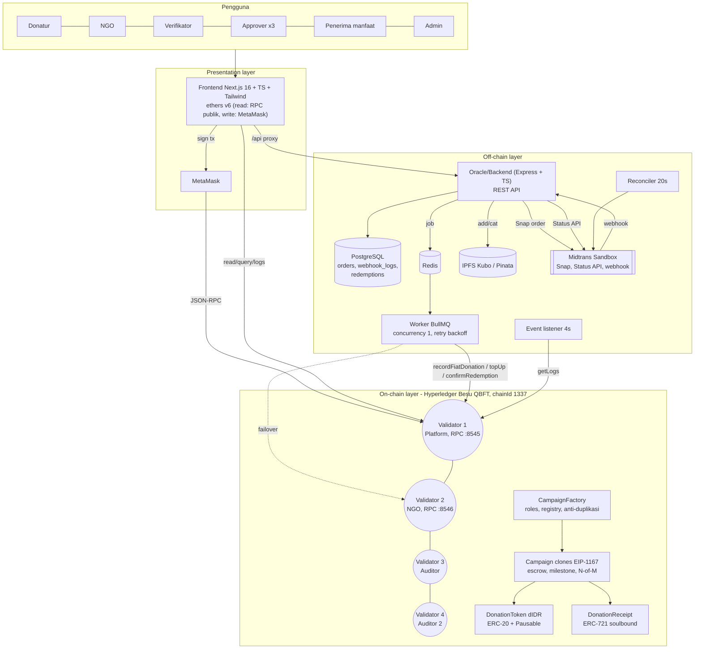

# Arsitektur Sistem

Diagram di bawah menggambarkan implementasi saat ini. (`architecture.png` adalah rancangan awal yang masih menyebut Geth/Clique.)



## Komponen

| Layer | Komponen | Teknologi | Tanggung jawab |
| --- | --- | --- | --- |
| Presentation | Frontend | Next.js 16, TypeScript, Tailwind 4, ethers 6 | Daftar & detail campaign, donasi rupiah/dIDR, timeline dana, dashboard role, verifikasi kuitansi, explorer, status transaksi |
| Presentation | Wallet | MetaMask (EIP-1193), `wallet_addEthereumChain`, `wallet_watchAsset` | Penandatanganan transaksi NGO/verifikator/approver/penerima/donatur dIDR |
| Off-chain | Payment oracle | Express + BullMQ + ethers | Verifikasi pembayaran Midtrans → transaksi on-chain |
| Off-chain | Reconciler | setInterval | Fallback Status API, re-enqueue job hilang, expire order |
| Off-chain | Event listener | `eth_getLogs` polling, checkpoint di DB | Off-ramp redemption, sinkronisasi order dari event |
| Off-chain | Database | PostgreSQL 16 | Order (orderId ↔ txHash ↔ receiptId), log webhook, data rekening off-ramp |
| Off-chain | Antrean | Redis 7 + BullMQ 5 | Antrean transaksi oracle, retry, dan deduplikasi jobId |
| Off-chain | Storage | IPFS Kubo 0.32 (atau Pinata) | File bukti, metadata, dan gambar campaign |
| On-chain | Private chain | Hyperledger Besu 24.12, QBFT, 4 validator, block 2 dtk, gas price 0 | Konsensus BFT antar pihak berbeda; toleransi 1 node mati |
| On-chain | Smart contract | Solidity 0.8.24, OpenZeppelin 5.0.2, Hardhat | Logika bisnis (lihat di bawah) |

## Alasan memilih Besu QBFT

Rancangan awal memakai Geth Clique. Karena Geth versi terbaru sudah tidak lagi mendukung jaringan Clique pasca-*The Merge*, dipakai alternatif yang sudah disebut di rancangan, yaitu **Hyperledger Besu** dengan QBFT:

- QBFT memberi *immediate finality* (tidak ada fork/reorg). Blok yang sudah masuk bersifat final, sehingga oracle cukup menunggu 1 konfirmasi.
- QBFT toleran terhadap kegagalan *Byzantine* hingga f = ⌊(n−1)/3⌋. Dengan 4 validator, 1 validator boleh mati atau berperilaku jahat.
- Besu kompatibel penuh dengan EVM, MetaMask, Hardhat, dan ethers, serta mendukung `min-gas-price=0` agar pengguna awam tidak perlu ETH.

## Desain smart contract

| Kontrak | Properti | Method | Event |
| --- | --- | --- | --- |
| **DonationToken** (dIDR, ERC-20, decimals 0) | `MINTER_ROLE`, `PAUSER_ROLE`, `OFFRAMP_ROLE`, `redemptions[]` | `mint`, `redeem(amount, bankRef)`, `confirmRedemption(id, payoutRef)`, `pause`, `unpause`, ERC-20 standar | `Transfer`, `Approval`, `RedemptionRequested`, `RedemptionPaid`, `Paused`, `Unpaused` |
| **CampaignFactory** | `NGO_ROLE`, `VERIFIER_ROLE`, `ORACLE_ROLE`, `token`, `receipt`, `implementation`, `fiatCap`, `threshold`, `campaigns[]`, `isCampaign`, `isRecipient`, `usedOrders`, `usedProofs` | `createCampaign(recipient, deadline, metadataCID, budgets[])`, `registerRecipient`, `topUp(orderId, to, amount)`, `setApprovers`, `setFiatCap`, `consumeOrder`, `consumeProof`, `getCampaigns`, `getApprovers` | `CampaignCreated`, `RecipientRegistered`, `ApproversUpdated`, `FiatCapUpdated`, `TopUpRecorded` |
| **Campaign** (clone EIP-1167) | `ngo`, `recipient`, `deadline`, `state`, `threshold`, `approverCount`, `totalBudget`, `totalDonated`, `totalPaid`, `reserved`, `refundPool`, `metadataCID`, `milestones[]`, `withdrawals[]`, `isApprover`, `votes`, `contributions`, `refunded` | `initialize`, `activate`, `cancel(reason)`, `donate`, `recordFiatDonation`, `requestWithdrawal(milestone, amount, proofHash, proofCID)`, `approveWithdrawal`, `rejectWithdrawal(id, reason)`, `cancelWithdrawal`, `executeWithdrawal`, `submitReport`, `claimRefund(donor)`, `summary`, `getMilestones`, `getWithdrawals`, `refundableOf` | `Activated`, `Cancelled`, `DonationRecorded`, `WithdrawalRequested`, `WithdrawalApproved`, `WithdrawalRejected`, `WithdrawalClosed`, `WithdrawalExecuted`, `ReportSubmitted`, `Refunded`, `Completed` |
| **DonationReceipt** (ERC-721 + ERC-5192 soulbound) | `factory`, `nextId`, `campaigns`, `receipts`, `receiptOfOrder` | `registerCampaign`, `mint`, `tokenURI` (JSON+SVG on-chain), `locked` | `Transfer`, `Locked` |

### State machine

```text
Campaign:   Pending --activate (verifier)--> Active --totalPaid == target--> Completed
               \                              |
                `--cancel (verifier/NGO)------`--> Cancelled --> claimRefund (proporsional)

Withdrawal: Pending --approve x threshold--> Approved --execute (NGO/approver)--> Executed --> submitReport*
               |  \--reject sampai kuorum mustahil--> Rejected   (dana cadangan dilepas)
               `----cancelWithdrawal (NGO)----------> Cancelled  (dana cadangan dilepas)
```

### Peran (role) dan akses

| Role | Disimpan di | Hak |
| --- | --- | --- |
| Admin | `DEFAULT_ADMIN_ROLE` factory & token | Memberi role, `setApprovers`, `setFiatCap`, pause token |
| NGO | `NGO_ROLE` | Membuat campaign; mengajukan, mengeksekusi, dan membatalkan pencairan campaign miliknya |
| Verifikator | `VERIFIER_ROLE` | Mendaftarkan wallet penerima, mengaktifkan atau membatalkan campaign |
| Approver | snapshot per campaign | Menyetujui/menolak pencairan (N-of-M), mengeksekusi setelah kuorum |
| Oracle | `ORACLE_ROLE`, `OFFRAMP_ROLE` | Mencatat donasi fiat/top-up, mengonfirmasi redemption. **Tidak** bisa memindahkan dana escrow |
| Penerima | `isRecipient` | Menerima pencairan, mengunggah laporan penyaluran, redeem dIDR |
| Donatur / publik | — | Donasi dIDR, klaim refund, membaca semua data |
